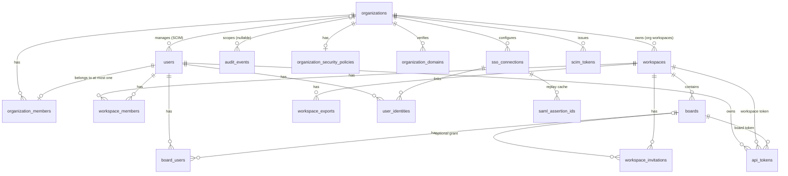

# Paying Organizations: Design

**Status:** design, 2026-10-17. Nothing described here is built yet unless it says "today" or "existing".

**Sources.** This design agrees with, and is derived from:

- the requirements document, [Paying organizations and free-tier limits for Stride](../ideation/2026-10-17T154403-paying-organizations-and-free-tier-limits-for-stride-requirements.md);
- the created goals and tasks in the [Stride batch file](../ideation/2026-10-17T154403-paying-organizations-and-free-tier-limits-for-stride-stride-batch.json) (G470 to G473);
- the rewritten goals G442 (workspaces, W2216 to W2222) and G445 (identity and compliance, W2244 to W2247), already applied on the board;
- the program's shared design decisions D1 to D12, which are restated in this document where they apply;
- the G442 workspace briefing, `docs/ideation/2026-10-17T112210-g442-workspaces-ui-briefing.md`. It was revised on 2026-10-17 to match this program, so it now agrees with this document. Where any source disagrees with this document, this document wins. [Decisions that supersede earlier sources](#153-decisions-that-supersede-earlier-sources) lists every difference, including what changed from the briefing's original version.

Task identifiers (G470, W2390 and so on) refer to the Stride board. [Work breakdown](#14-work-breakdown) maps each one to the section that describes it.

---

## 1. Purpose and scope

Stride earns nothing today. Every user gets every feature, any board can have any number of users, and a company has nothing to buy. This program adds a sales-led **Organization** plan that companies pay for off-platform, and a **free plan** that keeps individuals and small groups on Stride at no cost.

### Goals

- Two plans only. Free users keep unlimited boards with at most 3 human members each. Paying customers are ordinary users who belong to an Organization.
- Paid status **follows the board**. A board is paid when it sits in a workspace owned by an Organization. An Organization member's personal boards stay free.
- Eight paid-only features: Notifications, Audit, SSO, Workspaces, Bulk actions, Integrations, Telemetry and MCP. Each is closed at every entry point on free boards and shown locked with an "Available to organizations" prompt. Each prompt click is counted.
- One function decides paid versus free (`Kanban.Plans`). Every lock calls it.
- Nobody loses board access at launch. Boards over the cap are grandfathered.
- Stride's own boards run inside an internal Organization from launch day.
- `/pricing`, `/terms` and `/privacy` describe the free plan and the sales-led Organization plan.
- Success is measured by weekly locked-feature clicks per feature (leading) and at least 5 paying Organizations active within 6 months of launch (lagging).

### Non-goals

- **Payments and invoicing.** There is no Stripe, checkout, trial, invoice or seat billing. Removed task W2223 stays removed.
- **Self-serve Organization creation or upgrade.** Only a site admin creates Organizations.
- **Seat limits and extra tiers.** Organizations have no caps on users or boards.
- **Downgrading an Organization to free.** A site admin handles a lapsed contract by hand.
- **Locking metrics.** Board metrics pages and their exports stay free. "Telemetry" means only the task fields `telemetry_event` and `metrics_to_track`.
- **Locking the REST API.** Only `/api/mcp` is paid-only. Free agents keep claiming and completing tasks over REST.
- **Deleting an Organization.** There is no delete in v1.

---

## 2. Glossary

| Term | Meaning |
|---|---|
| **Free board** | A board whose workspace has no `organization_id`, which in practice means a board in a personal workspace. It holds at most 3 human members while plans are enforced, and paid features are locked on it. |
| **Paid board** | A board whose workspace has an `organization_id` (an org workspace). It has no member cap and every paid feature works on it. |
| **Organization** | A paying customer, created only by a site admin. It holds a name, a structured address and a contact (name, phone, email), its members, its org workspaces, and (through G445) its SSO, SCIM and security policies. |
| **Org-admin** | A user whose `organization_members.role` is `:org_admin`. Org-admins manage their Organization's workspaces, members, invitations, workspace tokens, exports, SSO, SCIM and policies, and get derived owner-equivalent access to every board in its workspaces. It is a role on the membership, **never** a `User.type` value. |
| **Site admin** | A user with `User.type == :admin` (existing). Site admins create Organizations, appoint and remove org-admins, and use `/admin/*`. Being a site admin grants no Organization rights and no board access. |
| **Organization member** | A user with an `organization_members` row of either role. A user belongs to at most one Organization. |
| **Personal workspace** | A workspace with `personal = true` and no `organization_id`, with exactly one owner row. Every user has one, created at registration or by the W2217 backfill. It is **hidden in the UI for every user**: its boards appear on `/boards` as "Personal boards", and it never appears in the switcher, the org console or workspace settings. |
| **Org workspace** | A workspace with `personal = false` and an `organization_id`. It has no owner row; the Organization owns it. Org-admins create, rename and archive it. Boards in it are paid. |
| **Plans enforced** | The runtime flag `config :kanban, :plans_enforced`, set from the environment variable `STRIDE_PLANS_ENFORCED`. It is `false` by default everywhere. While it is false, no lock and no cap applies, so every goal can merge before launch. Launch day sets it to true. |

---

## 3. Data model

### 3.1 Tables and columns

Migration timestamps in the task specs (`20261001...`) are placeholders. Real ones come from `mix ecto.gen.migration`. Where a task does not fix a detail, this section says "suggested".

#### `organizations` (new, W2390)

| Column | Type | Constraints |
|---|---|---|
| `id` | bigint | primary key |
| `name` | string | required, length capped |
| `address_line1`, `address_line2`, `city`, `region`, `postal_code`, `country` | string | optional, length capped |
| `contact_name` | string | required, length capped |
| `contact_phone` | string | optional, length capped |
| `contact_email` | string | required, email format, length capped |
| `inserted_at`, `updated_at` | utc_datetime | |

- There is no plan, paid or seat column. Paid status is derived from `workspaces.organization_id`.
- There is no delete function and no downgrade function.
- `name` is not unique by constraint. `Kanban.Release.ensure_internal_organization/1` (W2403) matches an existing Organization by exact name.
- `Kanban.Release.ensure_internal_organization/1` keeps its logic in `Kanban.Release.InternalOrganization`. It acts as a named enabled site admin and reads the Organization list and makes every write through `Kanban.Organizations` (`list_organizations/1`, `create_organization/2`, then `appoint_org_admin/3` per listed email), so the context's authorization check, telemetry and audit events apply. The name is trimmed and compared case-sensitively, and the lowest id wins when several match. An existing Organization's details are left as they are. The name is not reserved, so an existing match is reused only when Stride staff run it: it has org-admins and every one is a site admin or one of the listed `org_admin_emails`. Otherwise the run is refused with `:name_taken` and writes nothing, so a customer's Organization that happens to be called "Stride" never gets Stride staff appointed into it, including one with no org-admin yet (created but not yet staffed, or emptied by churn). A repeat run lists at least the same org-admin emails as the first, and a first run that appointed nobody needs an appointment in `/admin/organizations/:id` before it is run again. It provisions no accounts: unknown emails are reported as skipped, and disabled users and users in another Organization are reported as refused. A re-run writes nothing and reports the existing Organization and org-admins. A missing or `nil` name means "Stride"; `org_admin_emails` is a list or one comma-separated string, and anything else is refused before any write. Each run holds a Postgres advisory lock, so two concurrent runs cannot both create the Organization. It returns a summary map and never calls Mix.

#### `organization_members` (new, W2390)

| Column | Type | Constraints |
|---|---|---|
| `organization_id` | FK `organizations` | required, `on_delete: :restrict` |
| `user_id` | FK `users` | required, `on_delete: :delete_all` |
| `role` | string, `Ecto.Enum [:org_admin, :member]` | required |
| timestamps | | |

- **Unique index on `user_id`**: one Organization per user. A unique-index race maps to `{:error, :already_in_another_organization}`.
- Index on `organization_id`.
- `OrganizationMember` never casts `organization_id`, `user_id` or `role` from caller params.
- Invariant, enforced by the context under a row lock on the organization: an Organization keeps at least one org-admin while it has other members (W2391).

#### `workspaces` (new, W2216)

| Column | Type | Constraints |
|---|---|---|
| `name` | string | required |
| `slug` | string | required, unique |
| `personal` | boolean | default `false` |
| `organization_id` | FK `organizations` | nullable, `on_delete: :restrict` |
| `archived_at` | utc_datetime | nullable |
| timestamps | | |

- **Check constraint:** `personal` is true exactly when `organization_id` is null.
- Index on `organization_id` (suggested).
- `organization_id` is never cast from user attrs. `create_org_workspace/2` takes it from the caller's organization membership.
- `archived_at` belongs to W2216. W2396 adds no migration for it.
- **Names** are normalized before they are saved or compared: Unicode NFC, invisible characters stripped, then trimmed. The invisible characters are every Unicode format character (category Cf: zero-width spaces, direction marks and overrides, the soft hyphen, tag characters) plus the combining grapheme joiner and the Hangul fillers, which render as nothing. So "École" typed precomposed or decomposed, "Design" with a hidden zero-width space or direction mark, and a right-to-left override that would display "ngiseD" as "Design" all stop being look-alikes, and a name of only invisible characters is blank. The joiners U+200C and U+200D are kept, because scripts such as Persian and emoji sequences need them, and so are variation selectors; a subdivision flag such as England's, built from tag characters, becomes a plain black flag. A name with a NUL byte or invalid UTF-8 is a form error on `name`, never a database error.
- `Workspaces.add_member/4`, `update_member_role/4`, `remove_member/3` and `get_member_role/2` take a workspace struct or its id as an integer or a string, parsed like `get_workspace/2`: an id that cannot name a row (`"abc"`, past the column's range, `nil`) is refused like a missing workspace, never a crash.

#### `workspace_members` (new, W2216; role set changed from the G442 briefing)

| Column | Type | Constraints |
|---|---|---|
| `workspace_id` | FK `workspaces` | required |
| `user_id` | FK `users` | required |
| `role` | string, `Ecto.Enum [:owner, :member, :guest]` | required |
| timestamps | | |

- Unique on `(workspace_id, user_id)`.
- Partial unique index on `workspace_id` where `role = 'owner'`: at most one owner per workspace.
- Partial unique index on `user_id` where `role = 'owner'`: each user owns at most one workspace.
- **Trigger:** rejects an owner row on an org workspace, and a member or guest row on a personal workspace. Each rejection surfaces as a changeset error.
- **Role change:** the briefing's `admin` role is dropped. Org-admins replace it. Owner rows exist only on personal workspaces, and member and guest rows only on org workspaces.

#### `boards.workspace_id` (new column, W2216 then W2217)

- W2216 adds it as a nullable FK to `workspaces`, `on_delete: :restrict`, with an index. `Board` gets `belongs_to :workspace`, never cast from user attrs.
- W2217's second migration asserts that no board lacks a workspace and then sets `NOT NULL`.
- `board_users` is unchanged. Every legacy row keeps working, and `board_users_one_owner_per_board` still holds because derived access is never written.

#### `api_tokens` (changed, W2220)

- New nullable `workspace_id`, FK to `workspaces`.
- `board_id` becomes nullable.
- Check constraint: exactly one of `board_id` and `workspace_id` is set. Existing rows already satisfy it, so there is no backfill.

#### `workspace_invitations` (new, W2219)

| Column | Type | Notes |
|---|---|---|
| `workspace_id` | FK `workspaces` | the target workspace; for a free-board invitation, the board's personal workspace |
| `email` | string | the invitee, normalized |
| `role` | string enum `member` or `guest` | nullable; null for a board-only invitation |
| `board_id`, `board_access` | FK `boards`, enum | nullable; an optional board grant, never `owner` |
| `token_hash` | binary | unique; the plaintext appears only in the email link |
| `invited_by_id` | FK `users` | |
| `expires_at` | utc_datetime | 7 days after sending |
| `accepted_at`, `revoked_at` | utc_datetime | nullable |
| timestamps | | |

- Index on `(workspace_id, email)` for pending lookups. A duplicate pending invitation to the same email updates the existing row.
- Check constraint: each invitation carries a role, a board grant, or both.

#### `workspace_exports` (new, W2222)

| Column | Type | Notes |
|---|---|---|
| `workspace_id` | FK `workspaces` | org workspaces only |
| `requested_by_id` | FK `users` | |
| `status` | string enum | for example pending, running, ready, failed (values fixed in W2222) |
| `file_path` | string | server-side path under `config :kanban, :export_dir`; never taken from a client |
| `byte_size` | integer | |
| `expires_at` | utc_datetime | 7 days; a scheduled cleanup deletes the file |
| `error` | string | bounded failure summary |
| timestamps | | |

#### `audit_events.organization_id` (new column, W2397)

- Nullable FK to `organizations` with **no cascade** (`on_delete: :nothing`). A nullify cascade would edit audit rows, which the append-only trigger rejects.
- Index on `(organization_id, inserted_at, id)` for keyset paging.
- **No backfill.** The trigger refuses row edits, and every Organization event before this column lands predates launch.
- In a hardened database only the audit owner role can alter `audit_events`, so the migration runs as that role or a superuser there. See [audit log hardening](../audit-log-hardening.md).
- `Kanban.AuditLog.persist/2` copies an integer `organization_id` from the sanitized metadata into the column, and retries without it on a foreign-key failure, so a stale id never loses an event.

#### `audit_events.actor_in_organization` (new column, G470 exploratory fix)

- Nullable boolean: whether the event's actor was a member of its Organization **when the event was written**. `Kanban.AuditLog.persist/2` sets it, with one indexed query in the insert's savepoint, whenever an event has both an actor and an Organization, and leaves it `nil` otherwise.
- The Organization audit log redacts outside actors from this column (see [7.2 Audit](#72-audit)), not from who is a member now.
- **No backfill**, for the same reason as `organization_id`: the trigger refuses row edits. Rows written before it fall back to current membership; all of them predate launch.
- Like every `audit_events` change, the migration runs as the audit owner role or a superuser in a hardened database.

#### `organization_security_policies` (new, W2244)

| Column | Type | Constraints |
|---|---|---|
| `organization_id` | FK `organizations` | unique |
| `require_two_factor` | boolean | default `false` |
| `two_factor_grace_days` | integer | default 7, valid 1 to 30 |
| `two_factor_enforced_at` | utc_datetime | when the policy was enabled |
| `audit_retention_days` | integer | nullable (keep forever), valid 90 to 3650 |
| `updated_by_id` | FK `users` | nilified on user delete |
| timestamps | | |

- There is no per-member column: each member's grace deadline is computed as the later of `two_factor_enforced_at` and their join time, plus the grace days.
- W2244 also installs a new **Organization-scoped purge database function**, beside the existing `audit_events_purge`, through `Kanban.AuditLog.Hardening.Purge`. It removes at most N rows for one Organization (or, given no Organization, only rows with none) inserted before a cutoff, and refuses any cutoff inside the 90-day floor. It runs with its owner's rights and a pinned search path, executable only by the application role.

#### SSO tables (new, W2245 and W2246)

| Table | Columns and constraints |
|---|---|
| `organization_domains` | `organization_id` FK; `domain` **unique** (a domain can be verified by one Organization only); `verification_token`; `verified_at` |
| `sso_connections` | `organization_id` FK; `protocol` enum `oidc` or `saml`; `issuer`; `client_id`; `client_secret` encrypted with `Kanban.Encryption`; `settings` map; `enabled` boolean; timestamps |
| `user_identities` | `user_id` FK `on_delete: :delete_all`; `sso_connection_id`; `subject`; timestamps; **unique on `(sso_connection_id, subject)`** |
| `saml_assertion_ids` | `assertion_id` unique; `sso_connection_id`; `expires_at`. Replay protection, cleaned by `Kanban.Retention.PurgeWorker` |
| `saml_requests` (optional) | request id, `sso_connection_id`, relay path, `expires_at`. Server-side RelayState validation |

#### SCIM tables and columns (new, W2247)

| Change | Details |
|---|---|
| `scim_tokens` | `organization_id` FK; `name`; `token_hash` unique; `last_used_at`; `revoked_at`; `created_by_id` FK `users`; timestamps |
| `users.managed_by_organization_id` | nullable FK to `organizations`; no backfill, so existing users stay unmanaged. Set when SCIM creates the account. |

### 3.2 Entity-relationship diagram



Key invariants the diagram cannot show:

- a personal workspace has `organization_id` null, exactly one owner row and no member or guest rows;
- an org workspace has `organization_id` set and no owner row;
- an api token has exactly one of `board_id` and `workspace_id`;
- every board has a workspace after W2217.

### 3.3 Migration order

| # | Migration | Task | Notes |
|---|---|---|---|
| 1 | create `organizations`, `organization_members` | W2390 | first in the program |
| 2 | create `workspaces` (with `organization_id`, `archived_at`), `workspace_members`, nullable `boards.workspace_id`, owner trigger | W2216 | references `organizations` |
| 3 | add `audit_events.organization_id` | W2397 | needs only migration 1; run as the audit owner role in hardened databases |
| 3b | add `audit_events.actor_in_organization` | G470 exploratory fix | no backfill; run as the audit owner role in hardened databases |
| 4 | backfill personal workspaces | W2217 | set-based `execute` SQL; `down` is a documented no-op |
| 5 | set `boards.workspace_id` NOT NULL | W2217 | separate migration so a partial backfill fails loudly |
| 6 | create `workspace_invitations` | W2219 | |
| 7 | add `api_tokens.workspace_id`, nullable `board_id`, exactly-one check | W2220 | no backfill |
| 8 | create `workspace_exports` | W2222 | |
| 9 | create `organization_security_policies`; install the Organization-scoped purge function | W2244 | needs migration 3 |
| 10 | create `organization_domains`, `sso_connections`, `user_identities` | W2245 | |
| 11 | create `saml_assertion_ids` (and optional `saml_requests`) | W2246 | |
| 12 | create `scim_tokens`; add `users.managed_by_organization_id` | W2247 | |

**The W2217 backfill (migration 4) in detail:**

1. Create one personal workspace per user, with that user as its single owner row.
2. Set each board's `workspace_id` to its owner's personal workspace.
3. A board with no owner row goes to the personal workspace of its **earliest remaining member** (by `board_users` insertion time, then id).
4. A board with no members at all goes to the personal workspace of the **earliest enabled site admin**.
5. If such a board exists and no enabled site admin exists, the migration **raises with a clear message**.
6. It writes no member or guest workspace rows. Other board members keep access through their unchanged `board_users` rows.
7. Re-running it creates no duplicates. It logs the counts.

Placement grants nothing, because a personal workspace gives no derived access. There is no "Unassigned boards" workspace, since a workspace without an Organization must be personal.

---

## 4. Roles and authorization

### 4.1 Roles

| Role | Stored in | Grants |
|---|---|---|
| Site admin | `users.type = :admin` (existing) | `/admin/*`, including creating and editing Organizations and appointing or removing org-admins. No board access and no Organization rights. A site admin who is not an org-admin is refused at `/org`. |
| Org-admin | `organization_members.role = :org_admin` | Everything in their Organization: workspaces, members, invitations, workspace tokens, exports, the Organization audit log, SSO, SCIM and security policies, plus derived owner-equivalent access to every board in its workspaces. Cannot grant or remove org-admin. |
| Organization member | `organization_members.role = :member` | Paid access for user-level surfaces (the switcher, the notification bell). Board access only from explicit `board_users` rows. |
| Workspace member / guest | `workspace_members.role` on an org workspace | Visibility of that workspace in the switcher and its read-only member list. Board access only from explicit `board_users` rows. Member and guest are treated the same in v1. |
| Personal workspace owner | `workspace_members.role = :owner` on a personal workspace | Nothing beyond their `board_users` rows. Ownership of the hidden workspace only decides where personal boards live. |
| Board owner / modify / read_only | `board_users.access` (existing) | Exactly as today. Owner manages members, tokens, settings, archive and delete. |

### 4.2 Effective board access

`Kanban.Workspaces.Policy.effective_board_access/2` (W2218) returns the **stronger** of explicit board access and derived access. `Boards.get_user_access/2`, `owner?/2`, `can_modify?/2`, `get_board/2` and `list_boards/1` route through it. List functions use a batched variant that joins workspaces and organization membership once, never one query per board.

| Caller's relationship to the board ↓ / explicit `board_users` access → | none | read_only | modify | owner |
|---|---|---|---|---|
| Org-admin of the Organization that owns the board's workspace | owner-equivalent (derived) | owner-equivalent (derived) | owner-equivalent (derived) | owner |
| Member or guest of the board's org workspace | none | read_only | modify | owner |
| Organization member with no workspace row | none | read_only | modify | owner |
| Org-admin of a **different** Organization | none | read_only | modify | owner |
| Owner of the personal workspace that holds the board | none | read_only | modify | owner |
| Any user, board in a personal workspace | none | read_only | modify | owner |
| Site admin with no other role | none | read_only | modify | owner |

Rules this table encodes:

- **Org workspace boards:** only org-admins of the owning Organization get derived access.
- **Personal workspace boards:** `board_users` only, exactly as today, even for the workspace's owner.
- **Legacy rows** are always honoured. A user who is on a board through `board_users` but outside the Organization keeps that access after the board moves into it.
- A guessed board or workspace id from another Organization behaves like a nonexistent one.
- **Public boards** are the one exception to "none". A board with `read_only: true` is readable, and only readable, by every signed-in user who would otherwise have none (no `board_users` row and no derived org-admin access), in any workspace and from any Organization (`Boards.get_board/2` returns it with `user_access: nil`). This is intended; see [open question 14](#152-open-questions).

Owner-equivalent access opens every action that gates on `owner?/2`: edit, settings, members, API tokens, archive and delete. Whether delete is too strong for a derived role is an open question carried from the briefing (see [Risks and open questions](#15-risks-and-open-questions)).

### 4.3 Derived org-admin access

Org-admin access is computed on every check from `workspaces.organization_id` and `organization_members.role`, and **never written** as a `board_users` row. The reasons:

- **The one-owner-per-board constraint holds.** `board_users_one_owner_per_board` allows one owner row. Writing owner rows for every org-admin would break it.
- **Revocation is instant and complete.** When a site admin removes an org-admin, or SCIM deprovisions one, the next request loses access. There are no rows to find and delete, and no window where stale rows grant access.
- **Workspace tokens follow it.** `AuthenticateApiToken` re-derives the token user's effective access on every request, so a demoted org-admin's workspace token immediately falls back to that user's explicit board access (W2220).
- **Board tokens follow it too.** Not every access-loss path revokes a board token, so the API re-checks it per request. Writes already required live `:owner`/`:modify` access (`Boards.get_user_access/2`). Reads now require any effective access through the same function (`KanbanWeb.API.BoardReadAccess`, on every REST read and the MCP read tools). A refused read gets the documented `403` "board membership required" body, never a `401`, and records `permission_denied` with `gate: :api_board_read`. A public read-only board grants a token no read access of its own: the token's user must still have access.
- **Moving a board needs no row edits.** A board that moves into an org workspace (D8) becomes reachable by the Organization's org-admins with no `board_users` writes, and existing rows stay as they were.
- **The record stays honest.** `board_users` keeps meaning "explicitly shared", which exports, the members screen and the cap count rely on. Derived access never counts toward the free-board cap.

### 4.4 Who can do what

| Action | Who | Enforced in |
|---|---|---|
| Create or edit an Organization | enabled site admin | `Kanban.Organizations.create_organization/2`, `update_organization/3` |
| Appoint or remove an org-admin | enabled site admin | `appoint_org_admin/3`, `appoint_org_admin_by_email/4`, `remove_org_admin/3` |
| Create, rename, archive an org workspace | org-admin of that Organization | `Kanban.Organizations.OrgWorkspaces` (W2396) |
| Invite into an org workspace | org-admin | `Kanban.Workspaces.Invitations.invite_to_workspace/4` |
| Invite by email to an org board | org-admin only | `invite_to_board/4`, which becomes a workspace invitation |
| Invite by email to a free board | the board's owner | `invite_to_board/4`; acceptance counts toward the cap |
| Change a workspace member's role (member or guest) | org-admin | `Workspaces.update_member_role/4` |
| Remove a member from a workspace | org-admin | `Workspaces.remove_member/3` |
| Remove an ordinary member from the Organization | org-admin, in the `/org` console | `Kanban.Organizations.MemberRemoval.remove_member/3` (W2218), cascading board memberships and tokens in every workspace of the Organization, and **deleting the user's `workspace_members` rows in every workspace of the Organization**, so rejoining later never brings old access back. Any later path that ends an Organization membership must delete them too. |
| Move a personal board into an org workspace | an org-admin who owns the board | `Workspaces.move_board_to_workspace/3` |
| Create, list, revoke workspace tokens | org-admin | `ApiTokens.create_workspace_api_token/3` and friends |
| Request and download a workspace export | org-admin | `Kanban.Workspaces.Export` |
| Transfer board ownership | the explicit owner, or an org-admin for a board in their Organization | `Boards.transfer_board_ownership/3` |
| Delete own account | any user without blockers | `Kanban.Accounts.AccountDeletion` |
| Edit security policy, SSO, SCIM tokens | org-admin | G445 contexts |

Every management event re-checks the caller's role from the database. Hidden buttons are not authorization.

**Removal deletes owner rows too (W2218).** Removing a member from a workspace, or from the Organization, deletes every `board_users` row they hold on that workspace's boards, including an explicit owner row. This is the one path that may leave an org board with no explicit owner, and it does not strand the board: an org board is always reachable by the Organization's org-admins through derived access (§4.3), who can still manage its members. `Kanban.Workspaces.MembershipCascade` holds the cascade for both removals.

**A board always keeps its owner.** `remove_user_from_board/3` and `update_user_access/4` refuse the owner's own row with `{:error, :owner_required}`; the members screen flashes "The board owner can't be removed." Either write would leave a board nobody can see, stranded in the old owner's personal workspace and blocking that user's deletion. Ownership changes hands only through `transfer_board_ownership/3` (W2221), which changes both rows in one transaction itself rather than demoting the owner through `update_user_access/4`.

---

## 5. The plan check (`Kanban.Plans`)

`Kanban.Plans` (`lib/kanban/plans.ex`, W2398 and W2399) is **the only place that decides paid versus free**. Every lock, the cap and every paid gate calls it. Nothing else reads `:plans_enforced`.

### 5.1 API

| Function | Returns | Purpose |
|---|---|---|
| `enforced?/0` | boolean | Reads `Application.get_env(:kanban, :plans_enforced, false)` at call time |
| `paid_board?/1` | boolean | Board struct (uses a preloaded workspace, no query) or board id (one query). True only when the board's workspace has an `organization_id`. A board without a workspace is free. |
| `user_has_paid_access?/1` | boolean | User or Scope. Uses `scope.organization_membership` when present, else `Kanban.Organizations.get_membership/1`. True for a member of either role. |
| `board_unlocked?/1`, `user_unlocked?/1` | boolean | True when enforcement is off or the subject is paid. Render-time UI uses these. |
| `features/0` | list | `[:notifications, :audit, :sso, :workspaces, :bulk_actions, :integrations, :telemetry, :mcp]`, stable order |
| `parse_feature/1` | atom or `:error` | Explicit allow-list from string to feature atom. Never creates atoms. |
| `check_board/3` | `:ok` or `{:error, {:plan_required, feature}}` | `(board, feature, surface: s)`. Emits `feature_refused` on refusal. |
| `check_user/3` | same | `(user_or_scope, feature, surface: s)` |
| `paid_board_ids_query/0` | `Ecto.Query` | Composable subquery of board ids in org workspaces, for list filters such as the notification inbox |
| `free_board_member_cap/0` | `3` | The cap (W2400) |
| `member_cap_reached?/2` | boolean | `(board, current_count)`. True when enforced, not paid, and count is 3 or more. |
| `strip_locked_task_fields/2` | `{params, dropped_field_names}` | Drops `telemetry_event` and `metrics_to_track` from params (string or atom keys, including child task lists) when the board is locked (W2409) |

`surface` is one of `:live_view`, `:controller`, `:rest`, `:mcp`, `:oban`, `:context`. An unknown surface or feature raises in tests through strict telemetry.

### 5.2 Resolving paid status

- **Per board.** `paid_board?/1` looks only at `boards.workspace_id → workspaces.organization_id`. Who is asking does not matter, so an Organization member's personal board is free and a non-member on an org board sees it as paid.
- **Per user.** `user_has_paid_access?/1` is true for any Organization member. It decides whether **user-level** paid UI shows unlocked: the workspace switcher, the org console, the notification bell and the SSO settings section.
- **User-level features still resolve per board.** The bell shows only events from paid boards (`paid_board_ids_query/0` plus board-less rows), and an MCP request is allowed only when the token's current board is paid.
- **No caching.** Paid status is never cached in a process or ETS, because a board can move into an Organization at any time. The scope loads the membership once per request or mount with one indexed query, and LiveViews compute lock flags once at mount.

### 5.3 Feature registry and refusal helpers

- The feature registry is `features/0`. The lock component, the click controller and every check validate their feature against it.
- `check_board/3` and `check_user/3` are the refusal helpers. Callers translate `{:error, {:plan_required, feature}}` into the surface's own response: a translated flash in a LiveView, a warning in a REST body, a JSON-RPC error over MCP, a skipped job in Oban.
- Each refusal emits `[:kanban, :plan, :feature_refused]` with only `feature` and `surface`. It is not persisted, because free agents can trigger it at will.
- Paths that drop work silently without a user action behind it (notification generation, for example) do not emit `feature_refused`, to keep it meaningful.

### 5.4 The `:plans_enforced` flag lifecycle

| Stage | Value | How |
|---|---|---|
| Development, test, and production before launch | `false` | `config :kanban, :plans_enforced, false` in `config/config.exs`. `config/runtime.exs` sets it to true only when `STRIDE_PLANS_ENFORCED` is exactly `true`, and it defaults to false in every environment, including prod. |
| Tests that need locks | `true` for one test | A helper in `test/support/plans_helpers.ex` turns it on and restores the previous value on exit. Modules using it are `async: false`. |
| Launch day | `true` | Set `STRIDE_PLANS_ENFORCED=true` and restart. |
| Rollback | `false` | Unset the variable and restart. Locks never delete data, so nothing needs restoring (see [Launch plan](#12-launch-plan)). |

The flag is read at call time, never with `compile_env`, because launch flips it with a restart, not a rebuild. Unlike strict completion validation, it must not default to true in prod.

---

## 6. The free-board cap

### Rules

- A board in a personal workspace has at most **3 human members**, counted as `board_users` rows. The owner row counts. Agents and API tokens never count, because agents act through an existing user's token and are not board members. Derived org-admin access never counts, because it is never a row.
- Boards in org workspaces have no cap.
- The cap applies only while plans are enforced.
- Removals and access changes (`remove_user_from_board/3`, `update_user_access/4`, including ownership transfer) are never capped.
- Readers of a public board are never counted. A board with `read_only: true` is readable by every signed-in user, not only its members (`Boards.get_board/2`). Those readers have no `board_users` row, so `member_cap_status/1` never counts them, and adding rows for them would change who has access. This is intended: public boards stay free with any number of readers (decided 2026-10-20; see [open question 14](#152-open-questions)). The cap limits who can work on a free board, not who can read a board its owner made public. Making a board public shows everything on it to every signed-in user.

### Grandfathering by count

There is no grandfathered flag. An addition is refused whenever the count is **already 3 or more**. A board with 5 members at launch keeps all 5, refuses additions, and accepts one again once it is down to 2. Moving the board into an Organization ends the restriction.

### Enforcement paths

| Path | Task | Behaviour |
|---|---|---|
| `Kanban.Boards.MembershipChanges.add_user_to_board/4` | W2400 | In a transaction: row-lock the board, count `board_users`, refuse with `{:error, :member_cap_reached}` when `Plans.member_cap_reached?/2`. Two concurrent adds cannot pass 3. |
| Invitation acceptance (`Invitations.accept/2`) for a board grant on a personal-workspace board | W2219 | Refused with a clear cap message while the board is full. Board grants go through the cap-checked add path, never a direct insert. An invitation whose board has since moved into an Organization is not capped. |
| Registration from an invitation link | W2219 | Joins after email confirmation, subject to the same cap check. |
| Board move | W2218 | D6 lists the move as a cap path. The only move v1 allows is personal to org, which lifts the cap, so this check never refuses. The `via: :board_move` telemetry value stays reserved. **The move must broadcast `{Kanban.Boards, :members_changed, board_id}` on `"board:<id>"`** (the message `MembershipChanges` already sends for membership writes), so an open `/boards/:id/members` screen recomputes `member_cap_status/1` and drops the cap line without a reload. |

### User messaging

- `/boards/:id/members` (W2401) shows an "N of 3 people" line for a free board while enforcement is on, computed when the member list loads with `Boards.member_cap_status/1`.
- A disabled account still takes a seat: the cap counts every `board_users` row. The member list labels it **Disabled** (with a tooltip saying it can't sign in and still takes a seat), so the owner can see which seat to free.
- A disabled account is never added: the members search refuses to stage it, saying why, and `Boards.add_user_to_board/4` refuses it with `{:error, :user_disabled}`, read from the database.
- At or over the cap the add form is disabled with a translated explanation that free boards hold 3 people, and a link to `/pricing#contact`.
- A forced add at the cap gets a specific translated flash, not the generic changeset failure.
- A grandfathered board shows its real count (for example "5 of 3") with the same explanation and no removal prompt.
- Paid boards, and every board while enforcement is off, show no cap UI.

### Telemetry and reporting

- Each refusal emits `[:kanban, :board, :member_cap_reached]` once, through `Kanban.Boards.BoardTelemetry`, with `board_id`, `actor_user_id` and `via` (`:direct_add`, `:invitation`, `:board_move`). It is declared in `BoardEvents` with tag `via` and `persist: true`.
- W2219 does not emit a second cap event; the shared check already emits it.
- **Over-cap report (W2402):** `Kanban.Boards.over_cap_boards/0` lists personal-workspace boards with more than 3 `board_users` rows (board id, owner user id, member count) from one aggregate query. It is exposed as `mix kanban.over_cap_boards` in development and `Kanban.Release.report_over_cap_boards/0` in releases (`bin/kanban eval`). Both are read-only and print no names or emails. The mix task takes no arguments (it refuses any) and starts only the database connection, not the app, so Oban never runs during a report.

---

## 7. Paid feature locks

Every lock below is inert while plans are not enforced. Every lock is enforced on the server, at every entry point, not only by hiding a control. Account emails (confirmation, password reset, two-factor and invitations) are never locked.

### 7.1 Notifications

Notifications means the in-app bell, notification emails and digests (W2405, W2406).

| Entry point | Behaviour on a free board, or for a user without paid access |
|---|---|
| `Kanban.Notifications.notify/3` (context) | For a board-scoped event on a free board, inserts nothing, enqueues no email, returns `{:ok, []}`. Producers that call it (task comments, claim expiry and the rest) are covered here. |
| `Kanban.Notifications.Events.board_access_changed` | Checks the board it concerns; free board produces nothing. |
| `Kanban.Notifications.TargetStatusWorker` (Oban) | Skips owners without paid access. |
| `DigestFanoutWorker`, `DigestWorker`, `Digest.build` (Oban) | Include only paid-board activity, and only for users with paid access; users with neither receive no digest. |
| `Kanban.Notifications.EmailWorker` (Oban) | Sends only when the recipient has paid access **and** the board is paid, so a free member of a paid board gets no notification email. `notify/3` enqueues no job for such a recipient, and the worker re-checks both at send time. A job queued before the flag flipped, or before the board or the user left their Organization, is skipped with `email_skipped` reason `:plan_locked`. **Undelivered notifications are dropped.** |
| `KanbanWeb.NotificationsOnMount` and `KanbanWeb.NotificationBell` (UI) | A `notifications_locked` flag on the scope renders the bell with a lock and no badge. `KanbanWeb.UserAuth` computes it once per scope, from the Organization membership it already loads, so the lock costs no extra query and also covers controller-rendered pages. `NotificationsOnMount` skips the unread count and the PubSub subscription for a locked scope. |
| `/notifications` (`NotificationLive.Index`) and `/users/notifications` (`UserLive.NotificationPreferences`) | Render the locked panel for `:notifications`, plus links to the Review queue (`/review`) and My Work (`/my-work`) as the way to see waiting tasks. A preferences page opened before the lock applied switches to the panel on its first refused save. |
| `Kanban.Notifications.update_preference/3` (context, LiveView events) | Refused with `{:error, {:plan_required, :notifications}}`; crafted events get a flash. |
| Inbox query (`visible_query/1`) for paid users | Filtered to paid boards plus board-less rows. Hidden rows are not deleted; they reappear if the board becomes paid. |
| `Kanban.Notifications.unsubscribe/2` and the one-click unsubscribe route | **Never gated.** Turning email off is not a paid action. |
| `Kanban.Accounts.UserNotifier` (account emails) | **Untouched.** |

**What a free user sees:** a locked bell, a locked notifications page that points to `/review` and `/my-work`, and no notification emails or digests, including from paid boards they are a member of. The launch announcement tells free reviewers the same. A paid board still stores its notifications for a free member, and they appear if that user joins an Organization.

### 7.2 Audit

- The Organization audit log, `/org/audit` and `GET /org/audit/export` (W2397), is reachable only by org-admins, so it is closed to free users by the org-admin gate (`:require_org_admin` on_mount and `require_org_admin_user/2` plug). Non-org-admins are redirected to `/boards` with an audited `:permission_denied` event (gate `:require_org_admin`).
- The Organization filter is always forced from the signed-in org-admin's membership. `Kanban.AuditLog.Filters` never reads `organization_id` from params.
- **Outside actors are redacted.** An event caused by someone outside the Organization, such as a site admin creating it or appointing its org-admins, is shown and exported without that person's id, email or IP, so customers never see Stride staff accounts (`Kanban.AuditLog.OrganizationScope`). Whether the actor was outside is decided from `audit_events.actor_in_organization`, recorded when the event was written: an org-admin who later leaves still shows on their own past actions, and a site admin appointed org-admin later does not uncover what staff did before.
- **The export is capped and rate-limited (W2421).** One download holds at most 50,000 rows, newest first. Before the export's own audit row is written, a bounded count (it reads at most cap + 1 rows) decides whether the cap will cut the file. The export's own row counts when the filters admit it. A cut file carries an `x-export-truncated: true` header, and the `:org_audit_log_exported` event records `truncated: true`. The CSV or JSON still ends cleanly, with no marker row. Each org-admin may export 10 times an hour, through the `:org_audit_export` surface of `Kanban.RateLimit`. That limit is keyed on the signed-in user's id, so a second org-admin of the same Organization is not affected and varying the params does not reset it. A refused request is redirected to `/org/audit` with a translated flash. It writes no audit row and opens no stream. An unsupported format is refused before the limit is charged.
- The site-admin viewer at `/admin/audit-log` and its export are unchanged, and the site-admin export has no row cap or rate limit.
- **Gap:** no task places a locked "Audit" prompt on a surface free users visit, so the Audit click count will read zero. See [Risks and open questions](#15-risks-and-open-questions).

### 7.3 SSO

- The org console SSO page (W2245) is org-admin only, and its events call `Kanban.Plans` through the paid gate in `Kanban.SSO`.
- The single sign-on section of `/users/settings` shows users without paid access the lock component with feature `:sso`.
- SAML (W2246) uses the same gate and adds no second lock.
- The "Sign in with SSO" entry on `/users/log-in` only resolves Organizations by verified domain, so a free user has no connection to reach.

### 7.4 Workspaces

| Entry point | Behaviour for a user without paid access |
|---|---|
| Side-nav switcher slot (`lib/kanban_web/components/side_nav.ex`) | Rendered by the lock component for `:workspaces` while enforced; no slot while not. |
| `POST /workspace/switch` (`KanbanWeb.WorkspaceSessionController`) | Refused with a generic flash and no session change. |
| `/workspace/settings` (`KanbanWeb.WorkspaceLive.Settings`) mount and every event | Refused for users the plan check reports without paid access, and for users who cannot reach the workspace. |
| `/org` console | Org-admin only, which implies paid access. |
| Workspace tokens, invitations into org workspaces, exports | Org-admin only, inside workspace settings. |
| `/boards` | Users without a current workspace see today's flat list. |

### 7.5 Bulk actions

| Entry point | Behaviour on a free board |
|---|---|
| `KanbanWeb.BoardLive.Show` | `BulkSelection.assign_lock/2` computes `bulk_locked?` with `Plans.board_unlocked?/1` the first time the socket loads the board (the board loads in `handle_params`, not `mount`), and keeps it on later patches and filter changes. It reads the plan by board id rather than from a preloaded workspace, so the value is fresh. With enforcement off it never queries. |
| `KanbanWeb.BulkActionBar` (UI) | On a locked board the Select toggle stays for every viewer who can modify the board. Clicking it opens the lock component for `:bulk_actions` where the bar would be, and clicking it again closes it; there is no flash and selection mode never starts. Nothing is shown until the toggle is used. |
| `KanbanWeb.BoardLive.BulkSelection.handle_bulk_event/3` (LiveView events) | Refuses every `bulk_` event; `surface: :live_view`. `bulk_toggle_mode` opens or closes the lock component; every other event gets a translated flash and opens it. An event the plan check allows clears the lock, so a board moved into an Organization unlocks on its next event without a reload. |
| `Kanban.Tasks.BulkActions` (`move`, `assign`, `add_label`, `remove_label`, `archive`) | Returns `{:error, {:plan_required, :bulk_actions}}`; `surface: :context`. Checked once per call, not per task. |

Single-task moves, edits and archiving stay free. So does the Archive page's "Archive old (30d+)" action (`ArchiveLive.Index`, `Tasks.bulk_archive_completed_tasks_older_than/1`): it is housekeeping on completed tasks, not the selection-based Bulk actions feature, and is deliberately left unlocked.

### 7.6 Integrations

Integrations means board webhooks (W2408). Delivery targets (`Kanban.Targets`) are planning targets, not integrations, and are not locked.

| Entry point | Behaviour on a free board |
|---|---|
| `/boards/:id/integrations` (`BoardLive.Show :integrations`, `KanbanWeb.BoardLive.IntegrationsComponent`) | Locked panel for `:integrations`; existing endpoints listed read-only with a **Paused** badge. Every event except Deliveries and Delete is plan-checked, opening the edit form included; the first refusal switches a panel opened before the lock applied to the locked view. An event the component does not define is ignored. |
| `Kanban.Webhooks.create_endpoint/4`, `update_endpoint/4`, `rotate_secret/2`, `send_test_event/2` | Refused with `{:error, {:plan_required, :integrations}}`; crafted LiveView events get a flash. |
| `Kanban.Webhooks.delete_endpoint/2`, listing | **Allowed**, so owners can remove their configuration. |
| `Kanban.Webhooks.Events.emit/3` | Queues no delivery. Never raises into the task write path. |
| `Kanban.Webhooks.DeliveryWorker` (Oban) | Re-checks at perform time; finishes without an HTTP request and emits `feature_refused` with `surface: :oban`. |

**Paused, not deleted.** The endpoint's `enabled` field is never changed. The pause is derived from the plan, so deliveries resume automatically when the board moves into an Organization. Deliveries skipped while paused are not replayed. See [webhooks](../webhooks.md) for the existing delivery design.

### 7.7 Telemetry

Telemetry means the task fields `telemetry_event` and `metrics_to_track` (W2409). `logging_requirements` and integration-point telemetry events are not locked.

| Entry point | Behaviour on a free board |
|---|---|
| `POST /api/tasks` (`KanbanWeb.API.TaskCreation.create/3`, single task and goal with children) | Succeeds with its normal status. The fields are not stored on the task or any child. The body gains a top-level `warnings` list with one message saying the fields need an Organization. It is a gettext string, but API requests carry no locale, so like the rest of the API it is in English. `feature_refused` with `surface: :rest`. |
| `POST /api/tasks/batch` (`KanbanWeb.API.BatchGoalCreation`) | Same. |
| `PATCH /api/tasks/:id` (`KanbanWeb.API.TaskUpdate.update/3`) | Same. |
| `PATCH /api/tasks/:id/complete` | Unaffected; completion does not cast these fields. |
| MCP create or update | Locked earlier: MCP refuses free-board requests entirely (7.8). |
| Task form (`KanbanWeb.TaskLive.FormComponent`) | The two inputs are replaced by the inline lock; the save path strips them, and hidden inputs never submit empty strings that would wipe stored values. A form opened before the lock applied still shows the inputs: a save that changes them stores everything else, flashes that the telemetry changes were not saved (`KanbanWeb.TaskLive.Form.TelemetryLock`) and emits `feature_refused` with `surface: :live_view`. |
| Task view (`KanbanWeb.TaskLive.ViewComponent`) | Hides stored values. |
| REST reads (`GET /api/tasks/:id`, `/tree`, `GET /api/tasks`, `next`) | **Deliberately unchanged:** they still return values stored before the lock. Writes are what the lock refuses; reading old values uses no paid feature, and agents keep the context they were given. |

Requests without these fields get no `warnings` key. The strip uses `Plans.strip_locked_task_fields/2`, not `TaskParamFilter`'s forbidden lists, which log mass-assignment attempts. [POST /api/tasks](../api/post_tasks.md) and [PATCH /api/tasks/:id](../api/patch_tasks_id.md) document the warning.

### 7.8 MCP

- `POST /api/mcp` (`KanbanWeb.MCP.Server`, `handle_message/2` path) calls `Plans.check_board(conn.assigns.current_board, :mcp, surface: :mcp)` for every JSON-RPC request: `initialize`, `ping`, `tools/list` and `tools/call`.
- A refused request gets a JSON-RPC error object, not an HTTP error status. The code is a new one in the implementation-defined server range, exposed as `KanbanWeb.MCP.JsonRpc.plan_required/0`. It must not be `-32000`, which is already `server_error/0`. The message says MCP needs an Organization and that the REST API keeps working; `data` names the feature `mcp`. It never echoes the client's method or tool name.
- Batches return one error per request, with ids. Notifications and client responses still get 202 with no body. GET and DELETE still return 405. Unauthenticated requests still get 401 from the pipeline before any plan check.
- Each refused message is one `[:kanban, :mcp, :request]` span with outcome `:plan_required`.
- `:current_board` is the single seam: board tokens set it from the token, workspace tokens from the per-request selector (W2220), so the MCP lock needs no token-type logic. See [MCP](../MCP.md).
- **Requirement for workspace tokens (W2220):** the MCP lock and the REST telemetry strip (`KanbanWeb.API.LockedTaskFields.strip/2`) both read `conn.assigns.current_board`, and today a board token always sets it. A workspace-token request that selects no board must be refused before either runs, never treated as unlocked and never allowed to reach them with a `nil` board.

**What a free agent sees:** its MCP client receives an Organization-required error on every call; its REST calls keep working.

### 7.9 The lock component and click telemetry

`KanbanWeb.LockedFeature.locked_feature/1` (`lib/kanban_web/components/locked_feature.ex`, W2404) is the one locked UI.

- **Attributes:** `feature` (must be in `Kanban.Plans.features/0`; anything else raises), `variant` (`:inline` or `:panel`), and an optional `inner_block` slot rendering a disabled preview.
- **Rendering:** a lock icon, the feature's translated label and an "Available to organizations" prompt. Styling follows the ink tokens in the [dark mode contract](../dark-mode-contract.md), not opacity utilities.
- **Click path:** the prompt links (with `rel="nofollow"`) to `GET /locked/:feature`, served by `KanbanWeb.LockedFeatureController` in the authenticated browser scope. One controller route keeps one code path for LiveView and controller pages.
  1. `Kanban.Plans.parse_feature/1` validates the feature without creating atoms.
  2. A valid feature emits `[:kanban, :plan, :locked_feature_clicked]` with only `feature`, then redirects to `/pricing#contact`.
  3. An unknown feature redirects to `/pricing` with no event.
  4. `Kanban.Plans.LockedFeatureClicks` counts each user at most once per feature in any 7 days, the period the metric is read over. Over the limit the redirect still happens, without an event. The last counted click is stored per user and feature in the `locked_feature_clicks` table and checked with one atomic upsert, so the limit survives restarts and deploys and holds across machines; an in-memory limiter would let every user count again after each deploy. A user's rows are deleted with the user.
- **The metric:** `locked_feature_clicked` is declared in `PlanEvents` with a counter metric, tag `feature` and `persist: true`, so weekly clicks per feature can be read from `metrics_events`. The user id is not in the event; the metric is per feature.

---

## 8. Screens and routes

### 8.1 New and changed routes

| Route | Kind | Scope / live_session | Task |
|---|---|---|---|
| `/admin/organizations` | LiveView `Admin.OrganizationLive.Index` | `/admin` scope, `live_session :admin` (`:require_admin_user`) | W2393 |
| `/admin/organizations/new`, `/admin/organizations/:id/edit` | LiveView `Admin.OrganizationLive.Form` | `live_session :admin` | W2393 |
| `/admin/organizations/:id` | LiveView `Admin.OrganizationLive.Show` | `live_session :admin` | W2394 |
| `/org` | LiveView `OrgLive.Console` | `live_session :require_authenticated_user`; LiveView re-declares `on_mount {KanbanWeb.UserAuth, :require_org_admin}` | W2395, W2396, W2218 |
| `/org/audit` | LiveView `OrgLive.AuditLog` | same, with `:require_org_admin` | W2397 |
| `GET /org/audit/export` | `OrgAuditLogExportController` | browser + `:require_authenticated_user` + `require_org_admin_user` | W2397 |
| Org console Security, SSO and SCIM pages (for example `/org/security`, `/org/sso`, `/org/scim`; the tasks fix only "under `/org`") | LiveViews `OrgLive.Security`, `OrgLive.SSO`, `OrgLive.SCIM` | same as `/org` | W2244, W2245, W2247 |
| `GET /locked/:feature` | `LockedFeatureController` | browser + `:require_authenticated_user` | W2404 |
| `POST /workspace/switch` | `WorkspaceSessionController` | browser + `:require_authenticated_user` | W2218 |
| `/workspace/settings` | LiveView `WorkspaceLive.Settings` | `live_session :require_authenticated_user` | W2218 (sections from W2219, W2220, W2222) |
| `GET /workspace/exports/:id/download` | `WorkspaceExportController` | browser + `:require_authenticated_user` | W2222 |
| `/invitations/:token` | LiveView `WorkspaceLive.InvitationAccept` | `live_session :current_user`, because invitees may have no account | W2219 |
| `/users/register` | existing LiveView | gains invitation-token handling | W2219 |
| `/users/log-in` | existing LiveView | gains "Sign in with SSO" | W2245 |
| SSO start and callback | `SSOController` | browser scope, rate limited per IP (`:sso` surface) | W2245 |
| SAML SP metadata and ACS | `SAMLController` | dedicated `:saml` pipeline; only ACS skips CSRF and never relies on the session cookie | W2246 |
| `/scim/v2/*` (ServiceProviderConfig, ResourceTypes, Schemas, Users, Groups) | `SCIM.DiscoveryController`, `UserController`, `GroupController` | `AuthenticateScimToken` plug, `application/scim+json` | W2247 |
| `/users/settings` | existing LiveView | `live_session :require_sudo_mode`; gains Danger zone (W2221), single sign-on section (W2245), 2FA-disable refusal under policy (W2244) | W2221, W2245, W2244 |
| `/boards` | existing | grouping for users with a current workspace | W2218 |
| `/boards/:id/members` | existing | cap line (W2401), invite by email (W2219), open to org-admins through the policy (W2218) | W2401, W2219, W2218 |
| `/boards/:id` | existing | bulk bar locked (W2407); task form telemetry fields locked (W2409) | W2407, W2409 |
| `/boards/:id/integrations` | existing | locked panel, paused endpoints | W2408 |
| `/notifications`, `/users/notifications` | existing | locked panel | W2406 |
| `GET /api/boards` | `API.BoardController` | `:api` pipeline | W2220 |
| `POST /api/mcp` | existing | plan gate | W2410 |
| `/pricing`, `/terms`, `/privacy`, `/changelog` | existing public pages | rewritten content; `/pricing` gains `id="contact"` | W2412 to W2415 |

**Why these scopes.** Org-admins are ordinary signed-in users, so `/org` lives in the existing `live_session :require_authenticated_user` with an extra on_mount gate rather than a new live_session (a live_session name cannot be duplicated). Organization management is site-admin only, so it joins the existing `live_session :admin`. The invitation page must work logged out, so it joins `:current_user`. Account settings mutate credentials, so they stay behind `:require_sudo_mode`.

### 8.2 The org console (`/org`)

Built by W2395 and W2396, extended by W2218, W2397 and G445. Sections follow the `UserLive.Settings` pattern (sections plus a `select_section` event). Choosing a section patches the URL to `/org?section=<name>`, so each section can be linked to and survives a reload. An unknown or missing `section` shows Details. A task that adds a section adds its name to the console's `@sections` allow-list.

| Section | Contents | Task |
|---|---|---|
| Details | The Organization's name, address and contact, read-only. Only a site admin edits them. | W2395 |
| Members | Every member with name, email and role. A **Remove** action for ordinary members (not org-admins) that cascades board memberships and tokens in every workspace of the Organization. | W2395, W2218 |
| Workspaces | Active workspaces, create and rename forms, and archive. | W2396 |
| Audit log | Link to `/org/audit`. | W2397 |
| Security, SSO, SCIM | Policy form, domains and connections, SCIM tokens. | W2244, W2245, W2247 |

- `current_scope.organization_membership` (a new `Kanban.Accounts.Scope` field) is loaded by `KanbanWeb.UserAuth` with one indexed query for both the plug and the on_mount.
- Nothing reads an Organization id from params; the console always shows the signed-in org-admin's own Organization.
- The `:require_org_admin` on_mount also attaches a `handle_params` hook (`OrgAdminGate.recheck_params/3`) that re-reads the role from the database on every patch. Paging, filtering and tab changes patch the page without mounting it again, so without the hook an org-admin removed while `/org` or `/org/audit` was open could keep reading until they reloaded.
- **Only an enabled account is an org-admin.** `Organizations.org_admin?/2`, which the gate, the plug and the re-check all use, is false for a disabled user, so a disabled org-admin is refused on the next mount, patch or request. Disabling an account at `/admin/users` also broadcasts a disconnect to that user's open LiveView pages; the reconnect finds no session for a disabled user and signs them out.
- The Members list, here and on `/admin/organizations/:id`, labels a **Disabled** account and an enabled account that is **Unconfirmed**, each with a tooltip (`KanbanWeb.Components.AccountStatus`), so nobody relies on an account that cannot run the Organization. The `/org` Members list reloads each time the section opens.
- **Archiving a workspace only hides it.** It sets `archived_at`, removes the workspace from the switcher and lists, and deletes nothing. `OrgWorkspaces.archive_workspace/2` refuses with `{:error, :workspace_has_boards}` while the workspace still holds boards.
- An archived workspace takes no new members: `Workspaces.add_member/4` returns `{:error, :archived}`. Role changes and removals still work, so its members can be tidied up.

### 8.3 Site-admin screens

- `/admin/organizations` lists each Organization with name, city and country, contact name, and org-admin and member counts (one query).
- The form edits name, the six address fields and the three contact fields. There is no delete button.
- `/admin/organizations/:id` shows details, members and roles, an **Appoint org-admin** email form (always appoints `org_admin`), and a **Remove** button per org-admin with a confirmation.
- Errors map to translated flashes: `:already_in_another_organization`, `:last_org_admin`, `:user_disabled`, `:unauthorized`, changeset errors.
- `/admin/users` refuses to disable or delete the last enabled org-admin of an Organization that has other members, flashing that another org-admin must be appointed first. See [Removing org-admins](#9-organizations-lifecycle).
- Every event re-reads the actor and the Organization from the database. There is no new admin sidebar section; admin pages are reached by URL.

### 8.4 Workspace settings (`/workspace/settings`)

| Section | Org-admin | Member or guest |
|---|---|---|
| Members | List, change role (member or guest), remove (cascades board memberships and token revocation in this workspace) | Read-only list; crafted events get a denied flash |
| Boards | List, plus **Move a board here**: choose a board you own in your personal workspace (D8) | List |
| Invitations | Invite form (email, role, optional board and access), pending list with Resend and Revoke | Hidden |
| Tokens | Create (plaintext shown once, 90-day default expiry), list, revoke | Hidden |
| Export | Request export, status, Download when ready. Status is in-app only; there is no export-ready email. | Hidden |

Personal workspaces never appear here.

### 8.5 Side nav and the workspace switcher

- **Organization members:** a switcher lists their reachable, unarchived org workspaces (all of them for org-admins, those with a member or guest row for others), never a personal workspace. Choosing one POSTs `/workspace/switch`, which stores `current_workspace_id` in the session and redirects. `UserAuth` re-verifies it with `Workspaces.get_workspace/2` on every request and mount; a stale or foreign id falls back to the first reachable org workspace, or none, and never crashes or grants access.
- **Requirement for the switch and the re-check (W2218):** `get_workspace/2` returns archived workspaces and the caller's own hidden personal workspace, because other callers need them. The switch endpoint and the per-request re-check must refuse both, falling back exactly as for a stale id: a session must not keep working in, or create boards in, a workspace archived after it was chosen, and a forged switch request must never make the personal workspace current.
- **How W2218 meets it:** `Kanban.Workspaces.Current` resolves the session id against the same list the switcher shows (`Workspaces.list_workspaces_for_membership/2`, which leaves out archived and personal workspaces), so the per-request re-check and the switcher can never disagree. The switch POST uses `Current.switchable/2`, which also requires paid access from `Kanban.Plans` and refuses an archived or personal workspace that `get_workspace/2` returned.
- **Users without an Organization:** the switcher slot shows the lock component for `:workspaces` while plans are enforced, and nothing while they are not.
- **Org-admins** also get an **Organization** link to `/org`.
- The visual form of the switcher and the entry point to workspace settings are not fixed by the tasks (briefing §9.1 questions 3 and 4).

### 8.6 `/boards` grouping

- **Users with a current workspace:** three groups: the current workspace's boards, **Personal boards** (their personal workspace), and other shared boards they reach through `board_users`.
- **Everyone else, including every user without an Organization:** today's flat list, unchanged.
- New boards go into the current workspace when the caller is its org-admin or a member there, else into the caller's personal workspace. A `workspace_id` in submitted attributes is always ignored.

---

## 9. Organizations lifecycle

**Creation.** After a deal is signed off-platform, a site admin creates the Organization at `/admin/organizations/new` (`create_organization/2`). The actor must be an enabled site admin. `[:kanban, :organization, :created]` and the `:organization_created` audit action record it.

**Appointing org-admins.** On the Organization's admin page the site admin enters an email (`appoint_org_admin_by_email/4`):

- an existing enabled account is appointed, or promoted if it is already a member of this Organization;
- a disabled account is refused with `:user_disabled`. `appoint_org_admin/3` reads that from the database under the Organization lock, so a stale enabled struct is refused too;
- an account in another Organization is refused with `:already_in_another_organization`;
- an unknown email gets a new account with a random, never-shown password, created in one transaction with the membership. After commit, the existing confirmation and password-reset emails go out so the appointee sets their own password. The account is not pre-confirmed.

**Removing org-admins.** `remove_org_admin/3` deletes the membership (it never demotes), and refuses with `:last_org_admin` when other members would be left without one. The check runs under a row lock on the organization. Removing the only org-admin of an Organization with no other members succeeds. Like removing an ordinary member, it then cascades through every workspace of the Organization in the same transaction (`Kanban.Workspaces.MembershipCascade.remove_from_organization/2`): it deletes the user's `board_users` and `workspace_members` rows there, revokes their board and workspace tokens there, and unassigns their open tasks. Their personal boards and boards shared with them outside the Organization are kept, and appointing or adding them again later restores none of the old access.

**Only enabled org-admins count.** A disabled org-admin cannot sign in to run the Organization, so the last-org-admin check counts only enabled ones. The same rule guards the account itself: `AdminManagement.disable_user/2` and `delete_user/2` refuse with `:last_org_admin` when the target is the only enabled org-admin of an Organization with other members (`Organizations.ensure_not_last_working_org_admin/1`, inside the write's transaction and under the same organization row lock). An account that is already disabled can still be deleted, and a refused delete is audited as `:user_delete_refused` with that reason. The membership helpers behind these writes take integer ids from their callers; they are internal and do not parse strings.

**Inviting members.** Org-admins invite by email into an org workspace with role member or guest, and an optional board grant (W2219). Acceptance:

- requires a logged-in user whose email matches, ignoring case and surrounding whitespace;
- creates the organization membership with role `member` when the invitee has none, and never changes an existing org-admin role;
- is refused with the generic invalid-invitation message when the invitee belongs to another Organization;
- is refused with the same message, and the invitation revoked, when its sender may no longer send it: an enabled org-admin of the Organization for a workspace invitation, the board's enabled owner for a free-board invitation, or an enabled org-admin of the board's Organization once that board has moved into one. The check runs in the acceptance transaction, under the Organization or board lock;
- creates the workspace member row, never downgrading an existing role, plus the optional board grant;
- for a new user, happens after email confirmation.

On org boards, only org-admins invite by email. A free board's owner can still invite by email from the board members form; acceptance grants board access only and counts toward the cap. Sends are rate-limited per inviter (`:invite` surface).

**Moving boards in (D8).** An org-admin who owns a board in their personal workspace moves it into one of their Organization's workspaces from the workspace settings Boards section (`Workspaces.move_board_to_workspace/3`, one transaction). The move:

- lifts the cap, unlocks paid features and resumes paused webhooks;
- keeps every `board_users` row; members outside the Organization keep their board access and are not added to the Organization;
- keeps the board's open board-only invitations. They stay uncapped, and from then on accepting one needs its sender to be an org-admin of the board's Organization, as for any other org board, rather than only the board's owner;
- is refused for boards the caller does not own, boards outside their personal workspace, and workspaces of another Organization.

An org-admin cannot move a teammate's board; the teammate transfers ownership first, or the board stays free. There is no move back to a personal workspace.

**Transferring a personal board** (`Boards.transfer_board_ownership/3`, W2221) moves it into the new owner's personal workspace in the same transaction, so personal boards always live with their owner. The old owner becomes `modify`. An org board stays in its workspace.

**Member removal.** An org-admin removes an ordinary member from the Organization in the `/org` console (W2218). This deletes the organization membership, the member's workspace rows in the Organization, their `board_users` rows on the Organization's boards, and their API tokens for those boards. Org-admins cannot remove org-admins; only a site admin can. SCIM deprovisioning (section 10) does the same from the identity provider.

**Account deletion (D10, W2221).** Available to every user, free or paid, from the Danger zone in `/users/settings`, after re-entering the password and typing a confirmation phrase. Blockers:

- being the sole owner of a board other people use (with a link to transfer ownership);
- being the last org-admin of an Organization with other members (a site admin must appoint another);
- being the last enabled site admin.

Deletion runs in one transaction that re-checks the blockers. It deletes the user's personal workspace and the boards in it that only they use, re-homes any remaining board in it that others use (to its other enabled owner's personal workspace, else its earliest remaining enabled member's, else the earliest enabled site admin's; a disabled account never receives one, and a board none of them can take is deleted), removes the organization membership, workspace rows, board memberships, API tokens (including workspace tokens) and session tokens, revokes invitations they sent, nilifies task attribution, and records `:account_self_deleted` with the user id and no email. `AdminManagement.delete_user/2` keeps its existing guards and adds the last-enabled-org-admin guard (see Removing org-admins above).

**What does not exist in v1:**

- deleting an Organization;
- downgrading an Organization, or moving a board back out of one;
- self-serve Organization creation, upgrade, checkout or trial;
- an org-admin granting or removing org-admin;
- a member leaving an Organization on their own, other than by deleting their account;
- unarchiving a workspace.

**Workspace export and import (W2222).** Org-admins request a JSON archive (format version 1: a zip with a manifest plus boards, columns, tasks, comments, history and memberships) for an org workspace. An Oban job on a new `:workspace_exports` queue builds it, one job per workspace at a time. The archive excludes password hashes, token hashes, session and invitation tokens, and the Organization's address and contact. `mix kanban.import_workspace --file … --org-admin-email … [--dry-run]` restores it on a self-hosted instance into the named org-admin's Organization, in one transaction, remapping ids and matching users by email. Board access and task, comment and history attributions go only to matched members of that Organization; anyone else's are skipped or left empty and named in the report. It refuses an unknown format version or an email that is not an org-admin's, and never creates an Organization or imports into a personal workspace.

---

## 10. SSO, SCIM and security policies

All three are scoped to the **Organization**, not to a workspace (D11). They build on `Kanban.Organizations` and its org-admin check exactly as W2390 defines them, and never grant `org_admin` or decide Organization rights from `User.type`.

### Security policies (W2244)

- One `organization_security_policies` row per Organization, edited by its org-admins on a Security page in the org console. Other members, outsiders and site admins who are not its org-admins are refused on the server.
- **Require 2FA.** When enabled, each member without 2FA gets a grace deadline: the later of `two_factor_enforced_at` and the time they joined, plus `two_factor_grace_days`. Inside the grace period they see a banner with the deadline. After it, every authenticated browser request redirects to the two-factor section of `/users/settings` until they enroll; that section, log-out and the enrollment events stay reachable so nobody is stuck in a loop. While the policy applies, `Kanban.Accounts.TwoFactor.disable/2` refuses.
- **SSO sessions satisfy require-2FA**, because the identity provider owns MFA. Only a server-written session marker, set at SSO login by W2245 and W2246, counts. This is why W2245 depends on W2244.
- **API-token requests are never affected.**
- Turning the policy off, or leaving the Organization, removes the redirect and banner on the next request.
- **Retention.** `Kanban.Retention.PurgeWorker` runs daily on the existing `:maintenance` queue through `Oban.Plugins.Cron`. It removes each Organization's audit events older than its `audit_retention_days` in bounded batches through the Organization-scoped database purge function, never inside the existing 90-day floor. Rows with no Organization are removed only when a site-wide config setting is set; by default nothing is removed. The existing `audit_events_purge` and `Kanban.AuditLog.purge_before/1` are unchanged.
- **Archived-task retention is site-wide config**, not an Organization policy: the same worker removes archived tasks older than `archived_task_retention_days` (unlimited by default), never removing a goal while any child is not archived.
- Each run records a `retention_purge` audit event with counts; policy edits record `organization_policy_updated` with old and new values.

### OIDC (W2245)

- Org-admins add domains and prove ownership with a DNS TXT record (lookups through a resolver behaviour over `:inet_res`, stubbed in tests). A domain can be verified by only one Organization.
- Org-admins configure an OIDC connection (issuer, client id, client secret encrypted with `Kanban.Encryption`, never re-displayed). `{:oidcc}` is the preferred library.
- Login: "Sign in with SSO" looks up the Organization by the email's verified domain, then runs authorization code with PKCE, state and nonce bound to the session and single-use. The id_token's signature, issuer, audience, expiry and nonce are validated.
- **JIT provisioning** (`Kanban.SSO.Provisioning`, shared with SAML and SCIM): a new user is created confirmed, without a password, through an `Kanban.Accounts` function that keeps registration side effects such as the personal workspace, plus an organization membership with role `member`. An existing account is linked only when its domain is verified by that Organization and the provider asserts `email_verified`.
- A user in another Organization is refused with a generic message and an `sso_login_refused` audit event, and never moved. Later logins match on issuer and subject, not email. Disabled users cannot sign in.
- SSO start and callback are rate limited per IP (`:sso` surface).

### SAML (W2246)

- A second protocol on `sso_connections`. Org-admins upload IdP metadata or enter the entity id, SSO URL and signing certificate, and download Stride's SP metadata.
- The ACS validates the signature over the exact element consumed (against signature wrapping), audience, recipient and validity window, with XML external entities disabled. Each assertion id is accepted once (`saml_assertion_ids`).
- RelayState is validated against a server-stored request record and only allows local return paths.
- The ACS receives a cross-site POST, so it has its own `:saml` pipeline without CSRF protection and never relies on the SameSite=Lax session cookie. Only the ACS route uses it.
- Provisioning, the paid gate and the session marker are the same as OIDC. Library choice (samly or an alternative) is decided after a maintenance check.

### SCIM (W2247)

- SCIM 2.0 under `/scim/v2`, authenticated by Organization-scoped tokens stored hashed in `scim_tokens`, shown once, created and revoked by org-admins on a SCIM page in the org console. A token never reaches users or workspaces outside its Organization (404).
- `POST /Users` provisions through `Kanban.SSO.Provisioning` (verified domains only, role `member`, refusal of users in another Organization) and sets `users.managed_by_organization_id`.
- **Deprovisioning** (`active: false` through PATCH or PUT, or DELETE), in one transaction:
  - removes the organization membership, the user's workspace rows in that Organization, and their `board_users` rows on boards in its workspaces;
  - revokes their API tokens for those boards and disconnects their live sessions;
  - **disables the account only when SCIM created it** (`managed_by_organization_id` is this Organization), then also deletes every session token and revokes every API token (`Kanban.ApiTokens.revoke_all_user_tokens/1`);
  - never disables a site admin or an account it does not manage;
  - **never removes the last org-admin** of an Organization that still has other members.
- Re-activation restores a member-role membership (refused if the user has since joined another Organization) and re-enables a managed account, without restoring revoked tokens.
- Groups map to the Organization's workspaces: Group member PATCH adds or removes workspace membership with role `member`. Creating, renaming or deleting Groups through SCIM returns a SCIM error; org-admins manage workspaces in the console.
- Mutations are audited with `organization_id` and the SCIM token id, never the token value. Failures are rate limited (`:scim` surface).

---

## 11. Telemetry and audit events

New events follow the [naming rule](../telemetry.md#naming-rule) (`[:kanban, domain, past_tense_action]`), declare only ids, fixed labels and counts under the [privacy rule](../telemetry.md#privacy-rule), and are added to the catalog as described in [Adding an event](../telemetry.md#adding-an-event). After each catalog change, the event reference in `docs/telemetry.md` is refreshed so `test/kanban/telemetry_docs_test.exs` passes. Tests use `Kanban.TelemetryHelpers.attach_telemetry/2`.

### Telemetry events

| Event | Catalog module | Metadata (ids and labels only) | Persist | Task |
|---|---|---|---|---|
| `[:kanban, :organization, :created]`, `[:kanban, :organization, :updated]` | new `OrganizationEvents` | `organization_id`, `actor_user_id`, changed field names | per W2390 | W2390 |
| `[:kanban, :organization, :member_added]`, `[:kanban, :organization, :member_removed]` | `OrganizationEvents` | `organization_id`, `user_id`, `role`, `actor_user_id`, `account_created` (added) | per W2391 | W2391, W2392 |
| `[:kanban, :organization, :workspace_created]`, `:workspace_renamed`, `:workspace_archived` | `OrganizationEvents` | `organization_id`, `workspace_id` | per W2396 | W2396 |
| `[:kanban, :plan, :feature_refused]` | new `PlanEvents` (domain `:plan`) | `feature`, `surface` (tags) | **false** | W2399 |
| `[:kanban, :plan, :locked_feature_clicked]` | `PlanEvents` | `feature` (tag), counter metric | **true** | W2404 |
| `[:kanban, :board, :member_cap_reached]` | `BoardEvents` | `board_id`, `actor_user_id`, `via` (tag) | **true** | W2400 |
| `[:kanban, :announcement, :email_sent]`, `[:kanban, :announcement, :fanout_completed]` | `NotificationEvents` | count; no email address | per W2416 | W2416 |

Changed existing events:

- `[:kanban, :notification, :email_skipped]` gains reason `:plan_locked` (W2405).
- The `[:kanban, :mcp, :request]` span gains outcome `:plan_required` (W2410).
- The `[:kanban, :export]` span gains kind `:org_audit_log` (W2397).

W2218's member removal should reuse `[:kanban, :organization, :member_removed]` with role `member` rather than add a new event.

Metric tags stay low-cardinality (`feature`, `surface`, `via`), never ids. `feature_refused` is not persisted because free agents can trigger it at will; `locked_feature_clicked` is persisted and counted once per user and feature a week so it can drive the leading metric (see [which metrics are stored](../telemetry.md#which-metrics-are-stored)).

### Audit actions

New tuples in `@audit_actions` in `Kanban.Telemetry.Catalog.Families`, recorded through `Kanban.AuditLog.event/2` (whose signature does not change). Organization-scoped actions carry `organization_id`, which W2397 copies into the new column so `/org/audit` can show them. See [audit events](../telemetry.md#audit-events) for what the stored row keeps versus the telemetry copy.

| Action | Task |
|---|---|
| `:organization_created`, `:organization_updated` | W2390 |
| `:org_admin_appointed` (records whether an account was provisioned), `:org_admin_removed` | W2391, W2392 |
| three org-workspace actions (create, rename, archive; names fixed in W2396) | W2396 |
| `:org_audit_log_exported` | W2397 |
| `:permission_denied` with gate `:require_org_admin` (existing action, new gate value) | W2395 |
| `:org_member_added` (an invitation created the organization membership: `user_id`, `organization_id`, `member_user_id`, `invitation_id`, no email) | W2219 |
| `:org_member_removed` (an org-admin removed an ordinary member: `user_id`, `organization_id`, `member_user_id`) and `:permission_denied` with gate `:workspace_settings` | W2218 |
| `:account_self_deleted` (user id, no email) | W2221 |
| `:organization_policy_updated`, `:retention_purge` | W2244 |
| `:sso_login`, `:sso_login_refused`, state/nonce mismatches | W2245 |
| SAML logins (protocol `saml`) and replay rejections | W2246 |
| SCIM mutations (token id, never token value) | W2247 |

---

## 12. Launch plan

Every goal merges before launch with `:plans_enforced` false, so nothing locks early. The 6-month window for the lagging metric starts on launch day. W2417 writes the runbook as `docs/organizations-launch-runbook.md`; it lists the exact function names below.

### Before launch

1. **Over-cap report.** Run `Kanban.Release.report_over_cap_boards/0` and contact the owners of grandfathered boards.
2. **Public pages ready** (W2412 to W2414):
   - `/pricing` shows exactly two plans, Free and Organization, with no price, trial or seat wording, an Organization contact call to action using the existing contact email, an element with `id="contact"`, and an FAQ on who counts toward the cap;
   - `/terms` describes the free plan's limits and the separate Organization agreement, keeps the no-reduction promise for paid periods, and says free-plan features may change with notice;
   - `/privacy` lists the Organization data held and states that org-admins see members and the Organization audit log, including actor emails and IP addresses.
3. **Announcement** (W2415, W2416):
   - publish the dated `/changelog` entry: what becomes Organization-only, what stays free, the 3-person limit with grandfathering, webhooks paused not deleted, and the pointer to `/review` and `/my-work` for free reviewers;
   - post the broadcast message draft through `/admin/messages`;
   - run `Kanban.Release.send_launch_announcement/1` as a dry run (returns the recipient count), then for real. It enqueues one unique job per confirmed, enabled user on the `:notifications` queue. It is a service notice, so it is not gated by notification preferences or by the plan.

### Launch day

1. Deploy the rewritten pages.
2. Run `Kanban.Release.ensure_internal_organization/1` with an acting site admin's email, the name (default "Stride"), contact fields and the org-admin emails. It is idempotent and provisions no accounts. A repeat run must list at least the same org-admin emails as the first: an existing "Stride" with no org-admin, or whose org-admins are not all site admins or listed emails, is refused with `:name_taken`, so a customer's Organization of that name is never taken over.
3. Create the internal Organization's workspace in `/org` and move Stride's own boards into it with the W2218 board move.
4. Set `STRIDE_PLANS_ENFORCED=true` and restart.
5. Verify:
   - a free board shows the locks and refuses a fourth member;
   - a paid board works;
   - MCP is refused for a free board's token;
   - REST claim and complete still work on a free board;
   - account emails still send for free users.

### Measuring

Weekly locked-feature clicks per feature come from `metrics_events` rows for the `locked_feature_clicked` counter, grouped by the `feature` tag and by week. An illustrative query (confirm the metric name from the catalog entry):

```sql
SELECT date_trunc('week', recorded_at) AS week,
       metadata->>'feature'            AS feature,
       count(*)                        AS clicks
FROM metrics_events
WHERE metric_name = 'kanban.plan.locked_feature_clicked.count'
GROUP BY 1, 2
ORDER BY 1, 2;
```

### Rollback

Unset `STRIDE_PLANS_ENFORCED` and restart. Every lock and the cap switch off at once, and no data needs restoring, because locks never delete data: webhook endpoints keep their configuration, hidden notification rows reappear, and grandfathered boards kept every member. What rollback cannot bring back:

- notifications that were never generated, or were dropped at send time, while locked;
- webhook deliveries skipped while paused (they are not replayed);
- telemetry fields that free agents sent and Stride did not store.

Organizations, memberships and moved boards stay as they are; they are valid with or without enforcement.

---

## 13. Testing strategy

**Unit and context tests, per task.**

- `Kanban.Organizations`: authorization of every write, the one-Organization rule, the last-org-admin guard, and provisioning rollback when the membership insert fails.
- `Kanban.Workspaces`: every database rule (check constraint, partial indexes, trigger) surfaces as a changeset error.
- `Kanban.Plans`: every predicate with enforcement on and off; no query when the workspace is preloaded; `parse_feature/1` never creating atoms.
- Every lock's context function refuses on a free board and works on a paid board.

**Policy matrix (W2218).** Every role against every explicit access level, for boards in personal and org workspaces, including org-admins of another Organization and site admins. Every `handle_event` clause is tested with events crafted by a member or guest.

**Migration tests (W2217).**

- A database seeded with legacy boards (owned, ownerless with members, ownerless without members, no site admin) migrates with every `board_users` value unchanged.
- The no-site-admin case fails loudly.
- Re-running creates no duplicates.
- Fixtures create personal workspaces, so the suite keeps passing with NOT NULL.

**Concurrency tests.** Two concurrent adds cannot pass the cap (W2400), and two concurrent org-admin removals cannot leave zero (W2391), both under row locks.

**Enforcement switching.** Tests that change `:plans_enforced` use the `test/support/plans_helpers.ex` helper and are `async: false`. With enforcement off, every existing test passes unchanged.

**The side-door suite (W2411).** `test/kanban_web/plans/paid_feature_lock_integration_test.exs` is one `async: false` module. It enables enforcement and, for one free board and one paid board built with real Organizations and workspaces (Plans is never stubbed), drives every entry point:

- LiveView events: `bulk_` events, Integrations create/update/test, the task form with telemetry fields, notification preference updates;
- controllers: `GET /locked/:feature`, and the org audit export refusing free users;
- REST: create, batch and update with telemetry fields stripped and warned, and claim and complete still succeeding;
- MCP: `initialize` and `tools/call` refused;
- Oban: `EmailWorker`, `DigestWorker` and `Webhooks.DeliveryWorker` skip free-board work;
- emails: no notification email for free-board events, while confirmation and password-reset emails still send.

It asserts each feature works on the paid board, and that turning enforcement off restores the free board. It must fail if any single lock is removed from any single entry point. One assertion per entry point and feature is enough; it does not duplicate unit tests.

**Security tests.**

- Enumeration safety: workspace tokens naming foreign boards get the same body as nonexistent boards; invitation states share one message; another-Organization refusals are generic.
- Hashed-only token storage for invitations and SCIM tokens.
- SSO state, nonce and PKCE replay; SAML signature wrapping, XXE and assertion replay.
- SCIM tokens confined to their Organization.
- The require-2FA redirect-loop escape paths.
- `stride-security-review` runs on the auth, token, SSO and SCIM tasks.

**Telemetry and docs tests.** Every new event is asserted with `attach_telemetry/2`. `test/kanban/telemetry_test.exs` and `test/kanban/telemetry_docs_test.exs` guard the catalog and `docs/telemetry.md`. `test/kanban/docs_relative_links_test.exs` guards new and edited docs (see the [doc link contract](../doc-link-contract.md)).

**UI quality gates.**

- Every new string is translated in de, en, es, fr, ja, pt and zh with no fuzzy entries.
- `mix dark_mode.scan` passes, and pages are checked in both themes.
- No Ecto queries in LiveViews; modules stay under about 500 lines.
- Page controller tests assert the new `/pricing`, `/terms`, `/privacy` and `/changelog` wording.

**Exploratory testing.**

- Switching workspaces in two tabs, looking for writes into a stale workspace.
- A member removed while the workspace is their current one.
- An agent mid-claim when its user is removed or deletes their account.
- Free-agent MCP sessions across the flag flip.
- The launch-day checklist run against a staging copy.

---

## 14. Work breakdown

### Goals and tasks

| Identifier | Title (short) | Section |
|---|---|---|
| **G470** | Organizations, org-admins, site-admin and org-admin consoles | [3](#3-data-model), [4](#4-roles-and-authorization), [8](#8-screens-and-routes), [9](#9-organizations-lifecycle) |
| W2390 | `organizations`, `organization_members`, `Kanban.Organizations` | 3.1, 9 |
| W2391 | Membership writes and org-admin appointment rules | 4.4, 9 |
| W2392 | Appoint org-admins by email, provisioning accounts | 9 |
| W2393 | `/admin/organizations` list, create and edit | 8.3 |
| W2394 | Org-admin appoint and remove panel | 8.3 |
| W2395 | Org-admin authorization and the read-only `/org` console | 4.1, 8.2 |
| W2396 | Org workspace create, rename and archive | 8.2 |
| W2397 | Organization audit log: column, `/org/audit`, export | 3.1, 7.2, 11 |
| **G471** | `Kanban.Plans` and the free-board cap | [5](#5-the-plan-check-kanbanplans), [6](#6-the-free-board-cap) |
| W2398 | `Kanban.Plans` and the `:plans_enforced` flag | 5.1, 5.4 |
| W2399 | Feature registry, refusal helpers, plan telemetry | 5.3, 11 |
| W2400 | 3-member cap in `add_user_to_board` | 6 |
| W2401 | Cap on the board members screen | 6 |
| W2402 | Over-cap report (mix task and release function) | 6, 12 |
| W2403 | Idempotent internal Organization release function | 12 |
| **G472** | Paid feature locks at every entry point | [7](#7-paid-feature-locks) |
| W2404 | Lock component, prompt and click telemetry | 7.9 |
| W2405 | Stop generating and sending free-board notifications | 7.1 |
| W2406 | Lock the bell and `/users/notifications` | 7.1 |
| W2407 | Lock bulk actions | 7.5 |
| W2408 | Lock Integrations and pause webhooks | 7.6 |
| W2409 | Lock task telemetry fields | 7.7 |
| W2410 | Refuse `/api/mcp` for free boards | 7.8 |
| W2411 | Side-door integration suite | 13 |
| **G473** | Public pages and launch announcement | [12](#12-launch-plan) |
| W2412 | Rewrite `/pricing` | 12 |
| W2413 | Rewrite `/terms` | 12 |
| W2414 | Update `/privacy` | 12 |
| W2415 | `/changelog` announcement | 12 |
| W2416 | Launch announcement email fan-out | 12 |
| W2417 | Launch-day runbook | 12 |
| **G442** | Workspaces under Organizations (rewritten) | [3](#3-data-model), [4](#4-roles-and-authorization), [8](#8-screens-and-routes), [9](#9-organizations-lifecycle) |
| W2216 | Workspace and membership schema, `Kanban.Workspaces` | 3.1 |
| W2217 | Backfill hidden personal workspaces; wire creation | 3.3 |
| W2218 | Org-admin board access, switcher, workspace settings, board move, `/org` member removal | 4.2, 4.3, 7.4, 8.4 to 8.6, 9 |
| W2219 | Email invitations | 6, 9 |
| W2220 | Workspace-scoped API tokens, `GET /api/boards` | 3.1, 4.3 |
| W2221 | Self-service account deletion and board transfer | 9 |
| W2222 | Workspace export and self-host import | 9 |
| **G445** | Identity and compliance for Organizations (rewritten; W2240 to W2243 done) | [10](#10-sso-scim-and-security-policies) |
| W2244 | Security policies, require-2FA, retention purge | 10 |
| W2245 | OIDC SSO, verified domains, JIT membership | 7.3, 10 |
| W2246 | SAML SSO | 10 |
| W2247 | SCIM 2.0 with Organization-scoped tokens | 10 |

### Suggested order

1. **G470, starting with W2390.** Then W2391 to W2395 and W2397. W2396 needs W2216 for the `Workspace` schema, so it finishes after step 2.
2. **G442's W2216 and W2217.** The schema, the backfill and NOT NULL.
3. **G471.** W2398 needs W2216, because `paid_board?/1` reads `boards.workspace_id` and `workspaces.organization_id`. W2403 can run any time after W2391.
4. **G472.** Every lock needs W2398 and W2399. W2411 runs last in the goal.
5. **The rest of G442** (W2218 to W2222). W2218 needs W2395, W2398, W2400 and W2404.
6. **G445.** W2244, then W2245 (it depends on W2244 so SSO sessions satisfy require-2FA), then W2246; W2247 needs W2245 and W2216.
7. **G473, with W2417 last.** W2412 to W2416 can run any time, keeping their internal order (W2415 after W2412, W2416 after W2415). W2417 depends on all of them and documents steps that need W2402, W2403 and the W2218 board move.

The Stride batch API cannot express dependencies across goals, so the cross-goal needs above (W2396 and W2398 on W2216, G472 on G471, W2218 on G470 to G472) are enforced by this order, not by the board.

---

## 15. Risks and open questions

### 15.1 Risks

| Risk | Source | Mitigation |
|---|---|---|
| Active free users leave rather than accept losing Notifications, MCP, Bulk actions and webhooks, and the losses outweigh the Organizations gained. This is the riskiest assumption (low confidence). | Requirements assumption (R), premortem | Advance announcement on `/changelog`, broadcast and email; Review queue and My Work as the free substitute for review emails; REST stays free; rollback is a flag flip. Watch the click metric and churn from launch. |
| A sales-led, manual process cannot sign 5 Organizations in 6 months. | Requirements assumption (low) | The click metric shows demand per feature early; `/pricing#contact` is the single funnel. |
| A side door undercuts a paid feature (UI, REST, MCP, old tokens, direct URLs, emails, jobs). | Requirements assumption, premortem | One plan check; server-side checks at every surface; send-time re-checks in Oban; W2411 fails when any lock is removed. |
| The migration or the cap takes someone's access away. | Requirements assumption, premortem | The backfill writes only owner rows; `board_users` untouched; grandfathering by count; migration tests assert every legacy access value. |
| The scope slips past the 6-month window, because everything ships at once. | Requirements design challenge | Goals merge independently behind `:plans_enforced`; the order in [Work breakdown](#14-work-breakdown) puts shared foundations first. |
| Review-request emails stop for free reviewers, so tasks sit in Review unnoticed. | Premortem blind spot | Locked notification pages and the announcement point to `/review` and `/my-work`. |
| Free users' MCP agents break mid-session at the flip. | Premortem blind spot | A clear JSON-RPC error naming the REST API as the free path; announced in advance. |
| Existing webhooks on free boards stop sending. | Premortem blind spot | Paused, not deleted; resume automatically on a board move; Paused badge in the UI. |
| Stride's own boards lose features at launch. | Premortem blind spot | Internal Organization and board move are launch-day steps, before the flag flip. |
| A site admin disables or deletes the last working org-admin's account through `/admin/users`, leaving members without an org-admin. | This design, G470 exploratory session | Guarded: both refuse with `:last_org_admin`, counting only enabled org-admins, under the organization row lock. |
| An org-admin exports the whole Organization audit log at once, or loops the download. Before W2421, `GET /org/audit/export` streamed every matching row with no row cap or rate limit, and every request also wrote an audit row. | G470 exploratory session; 2026-10-19 exploratory sessions | **Mitigated (W2421).** Streamed in batches, so memory stays flat. Each download is capped at 50,000 rows, and each org-admin may export 10 times an hour. A refused request writes no audit row (see [7.2 Audit](#72-audit)). Residual: an event written by someone else between the truncation count and the first batch can push the oldest row out without the truncation flag. The cap itself always holds. |
| `feature_refused` volume from free agents. | W2399 | Not persisted; tags are low-cardinality. |

### 15.2 Open questions

Carried from the requirements, with what this design settles:

1. **Where is the org-admin role stored?** *Settled:* on `organization_members.role`, never `User.type` (D2).
2. **What happens at the launch cutoff for each feature?** *Settled:*
   - MCP gets a JSON-RPC Organization-required error;
   - webhooks are paused, not deleted;
   - undelivered notifications are dropped at send time;
   - free reviewers are pointed to `/review` and `/my-work` by the locked pages, the changelog and the announcement email.
3. **What counts as "using" a locked feature?** *Partly settled:* for the metric, a click on the prompt (`GET /locked/:feature`), rate limited per user. *Open:* the announcement goes to every confirmed user rather than only users who used a now-locked feature; whether to target it is undecided.
4. **Can an org-admin move a board they don't own?** *Settled:* no. Only the owner moves a board (D8); a teammate transfers ownership first.

Raised while writing this design, or carried from the G442 briefing:

5. **Audit lock placement.** No task shows a locked "Audit" prompt on a surface free users visit, so Audit clicks will always read zero. Decide whether to add one (for example on board settings or the side nav) or to drop Audit from the click metric.
6. **MCP with workspace tokens.** W2220 returns 400 when a workspace token sends no board selector to a board-bound endpoint. If `/api/mcp` counts as board-bound, MCP clients must send `X-Stride-Board`, which some clients cannot configure. Decide whether MCP needs per-tool board selection.
7. **Derived owner rights include board deletion.** Should org-admin rights stop short of deleting a board or changing its ownership? (Briefing §9.3 question 14.)
8. **Unarchiving workspaces.** Archiving only hides a workspace and is refused while it holds boards; there is no unarchive in v1.
9. **Leaving an Organization.** A member cannot leave on their own except by deleting their account.
10. **Switcher form and settings entry point.** The visual form of the switcher, the mobile drawer, and how users reach `/workspace/settings` are not fixed (briefing §9.1).
11. **What follows the current workspace.** Only `/boards` follows the switcher. My Work, Agents, Review queue, Metrics and targets stay cross-workspace; the "Workspace" label on the nav landmark, the `/boards` breadcrumb and `MetricsLive.Workspace` may confuse people (briefing §9.1).
12. **Invitation rate limits.** Thresholds for the `:invite` surface are not specified. (Locked-feature clicks are counted once per user and feature a week; see 7.9.)
13. **The launch date.** The changelog entry keeps the date sentence easy to edit until the team agrees one.
14. **Public read-only boards and the cap.** *Settled (2026-10-20, Jeffrey S. Morgan, product owner):* intended. Public boards stay free, with any number of readers, in personal and Organization workspaces alike; they are not paid, capped or limited to Organizations (option A in W2422). Why: the cap limits who can work on a free board, and a reader of a public board can only read it. Readers have no `board_users` row, and adding rows for them would change who has access, so the cap never counts them (see [The free-board cap](#6-the-free-board-cap)). No code changes: `Boards.get_board/2` already gives every signed-in user without other access a read-only view of a board with `read_only: true`, and only a caller with owner access (including derived org-admin access) can set that flag. Public boards expose their content to every signed-in user, not only to members; anonymous visitors cannot see them. Owners should make a board public only when everything on it may be seen by anyone with an account. (Raised by the follow-up exploratory session.)

### 15.3 Decisions that supersede earlier sources

These are the places where the sources disagreed, and how this design resolves them. Rows that start "Briefing:" describe the briefing as first written; its revised version already follows this design.

| Earlier source said | This design | Why |
|---|---|---|
| Briefing: workspace roles `owner \| admin \| member \| guest`; admins manage workspaces | Roles `owner \| member \| guest`; org-admins replace workspace admins | D3, W2216 |
| Briefing: every user's personal workspace is visible, takes members, and is the switcher's default | Personal workspaces are hidden, have exactly one owner and no member or guest rows; the switcher lists only org workspaces | D3, W2216, W2217 |
| Briefing: the backfill adds non-owner board members to the owner's workspace (`modify` → member, `read_only` → guest) | No member rows are written; members keep `board_users` access | W2217; personal workspaces give no derived access |
| Briefing: ownerless boards go to an "Unassigned boards" workspace owned by the earliest site admin | Earliest remaining member's personal workspace, else the earliest enabled site admin's, else the migration fails | W2217 and the program's extra decisions |
| Briefing: `Workspaces.transfer_ownership/3` for workspaces | No workspace transfer; board transfer moves a personal board into the new owner's personal workspace | W2221 |
| Briefing: export promises an email when ready | In-app status only | W2222 |
| Briefing: `mix kanban.import_workspace --owner-email` | `--org-admin-email`, importing into that org-admin's Organization | W2222 |
| W2396: add `archived_at` "if W2216 does not provide one" | W2216 adds it; W2396 adds no migration | W2216 database changes |
| W2396 adds `OrgWorkspaces.create_workspace/3`; W2216 adds `Workspaces.create_org_workspace/2` | One creation path: `OrgWorkspaces.create_workspace/3` delegates to `create_org_workspace/2` | Avoids two writers for the same invariant |
| D11: `audit_events.organization_id` is added by "the org schema / org audit task" | It is added by W2397 (the Organization audit log), not W2390 or W2244 | Batch file, W2244 pitfalls |
| D6: the cap is checked when moving a board | The only move is personal to org, which lifts the cap, so the check never refuses; `via: :board_move` stays reserved | D8, W2218 |
| W2395: no member removal in the console | W2218 adds removing ordinary members to the console's Members section | Program decision; W2395 builds the console, W2218 extends it |
